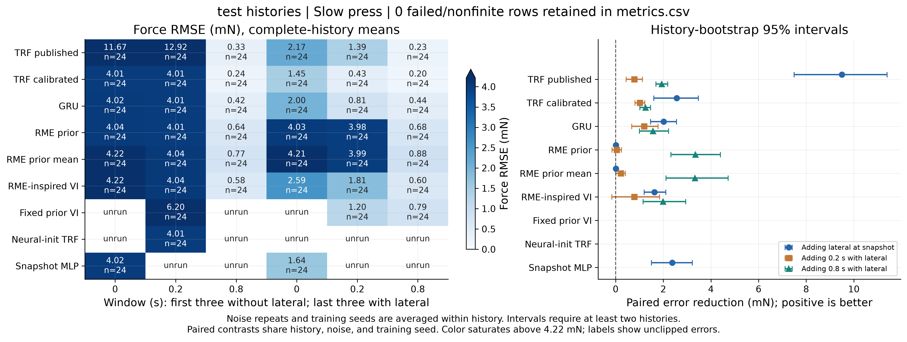

# Spatial contact and hidden state

[Repository](../README.md) · [Run](#run) · [Results](#results) · [Experiment design](#experiment-design) · [Related reading](#related-reading) · [Files](#files)

A circular indenter loads a viscoelastic body, releases it and makes contact again. We test how much current lateral shape reveals about its state, and what contact and recovery history add to future-response prediction.

## Run

1. Open the repository in VS Code and choose **Dev Containers: Rebuild and Reopen in Container** to include the learning dependencies.
2. Open [spatial_2d_hidden_state.ipynb](notebooks/spatial_2d_hidden_state.ipynb).
3. Select the container's **Python 3.11.9** and **Run All**.

Run All computes one fresh spatial trajectory and replays recorded comparisons. Sliders control playback; Run and Recompute buttons control calculation. New observer comparisons are stored separately from the published results.

[Docker setup](docs/CONTAINER.md) · [Parameters](docs/CONFIGURATION.md) · [Batch commands](tools/README.md) · [Report 10.2](../research/presentations/10.2/README.md)

## Results

### Auxiliary methods

The main estimator fits the window-start state by bounded nonlinear least squares, solved with TRF. Two auxiliary methods estimate the same state before the shared FEM predicts its response:

- **GRU:** maps an observation window directly to state coefficients, reducing online fitting cost.
- **RME-inspired VI:** refines a learned state prior using the FEM observation likelihood and samples possible future responses.

The [completed comparison](runs/inference/methods_20261030/RESULTS.md) uses 24 fresh test histories, three noise repeats and three training seeds. The previous 24 histories are reanalyzed separately.

| Method | Force RMSE, mN | Warm application time, s |
| --- | ---: | ---: |
| Calibrated TRF | 0.197 | 4.400 |
| GRU | 0.437 | 0.725 |
| RME-inspired VI | 0.605 | 17.344 |

Errors use Slow press on the new test batch with lateral sensing and 0.8 s history. Timings use one fixed pilot case, CPU batch one and one thread; VI includes 16 posterior rollouts. GRU is faster but less accurate here; VI does not improve on calibrated TRF.

Current lateral shape and contact/recovery history remain useful, while their measured gains depend on the estimator and training prior. Weak-window predictions can come almost entirely from that prior. Probability checks distinguish state, force and measurement uncertainty and quantify the limitations of 16-sample intervals.

[Section 6 in the Notebook](notebooks/spatial_2d_hidden_state.ipynb) · [Protocol and commands](docs/INFERENCE_STUDY.md) · [Configuration](configs/inference_study.json) · [RME paper/code check](docs/RME_ADAPTATION.md)

Git includes complete metrics, model weights and the first prescribed test history for interactive replay. The full raw archive stays local. The [publication check](runs/inference/methods_20261030/verification/publication/validation.json) passed 23 tests, clean-kernel Run All and replay/recomputation callbacks using only tracked files in Docker.

### Sensor channels and contact history

The [recorded comparison](runs/information/channels_contact_20261026/RESULTS.md) uses 24 independent histories and three noise draws per history. With the original observer, current lateral shape reduces mean Slow-press force error from 11.50 to 2.20 mN; recent lateral history reduces it to 1.29 mN over 0.2 s and 0.23 mN over 0.8 s. The same estimates also predict Fast press.

For this observer, lateral recovery measurements help during waiting; earlier contact plus motion propagation helps when lateral sensing is absent. [Section 5 of the Notebook](notebooks/spatial_2d_hidden_state.ipynb) provides sensor, window and future-action controls. These gains depend on the estimator and its initialization. The original pilot below is retained; its noisy-short-window loss did not generalize to this 24-history batch.

### Pilot results

Start with [the recorded pilot](runs/2d_contact/pilot_c9dd23016896/RESULTS.md). It contains eight independent test histories, the force-error comparison and the retained penetration-limit failure.

The recorded pair has identical endpoint tool position, velocity and contact force. The lateral-marker residual is 2.18 um against a 5 um matching tolerance. The same slow-press command produces a maximum force difference of 9.65 mN in simulation. Geometry is displayed at 1:1 deformation scale; the response axes include zero.

The pair was selected from current measurements before computing the future response. All five current channels are shown. The remaining lateral difference can still provide instantaneous information; this pair alone does not establish that history is necessary. [Source data](docs/figures/hidden_state_pair.csv) · [Conditions and provenance](docs/figures/hidden_state_pair.json) · [SVG](docs/figures/hidden_state_pair.svg) · [PDF](docs/figures/hidden_state_pair.pdf).

Short history helps in noiseless prediction and degrades under nominal noise. Full replay benefits from known parameters and a relaxed initial state. This pilot does not compare controllers.

## Experiment design

The material, geometry, contact and future solver stay fixed. Channel masks and observation windows change what the estimator can use. This separates sensing and history effects from changes to the physical model. Full replay additionally knows the relaxed initial state; the true-state reference receives the internal fields.

[Design and comparison conditions](docs/DESIGN.md) · [Physical model and estimators](docs/README.md)

## Related reading

The [literature review](docs/LITERATURE_REVIEW.md) compares moving horizon estimation, RKN, KalmanNet, RoboPack and RME against the completed results, with paper sections and pinned code links.

The next useful comparison is whether retaining an estimate helps after contact data leaves the recent window. Start with a classical recursive observer; consider a learned correction only if it addresses a measured weakness. These are proposed experiments. History encoding and neural-prior inference alone are not new contributions.

[Earlier method audit](../research/hidden_state_reframing/closest_work.md) · [State formulation](../research/hidden_state_reframing/formalization.md) · [RME adaptation](docs/RME_ADAPTATION.md)

## Files

| Location | Contents |
| --- | --- |
| [notebooks/](notebooks/) | Interactive experiment and cached-result controls |
| [src/nr2d/](src/nr2d/) | Solver, estimators, experiment functions and plots |
| [configs/](configs/) | Physical parameters and observer settings |
| [environment/](environment/) | Docker image and pinned dependencies |
| [tests/](tests/) | Physical, information-use and configuration regressions |
| [tools/](tools/README.md) | Execution, figure export and validation commands |
| [docs/](docs/README.md) | Model, design, setup and configuration details |
| [runs/](runs/README.md) | Results, raw data, figures and execution records |
