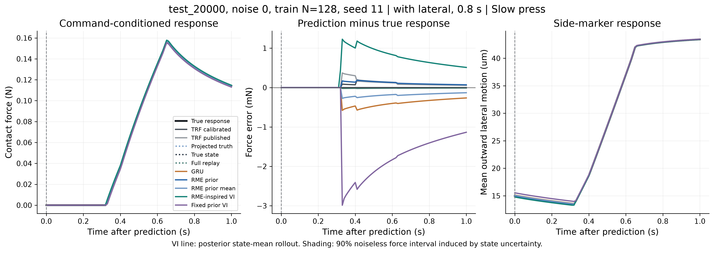
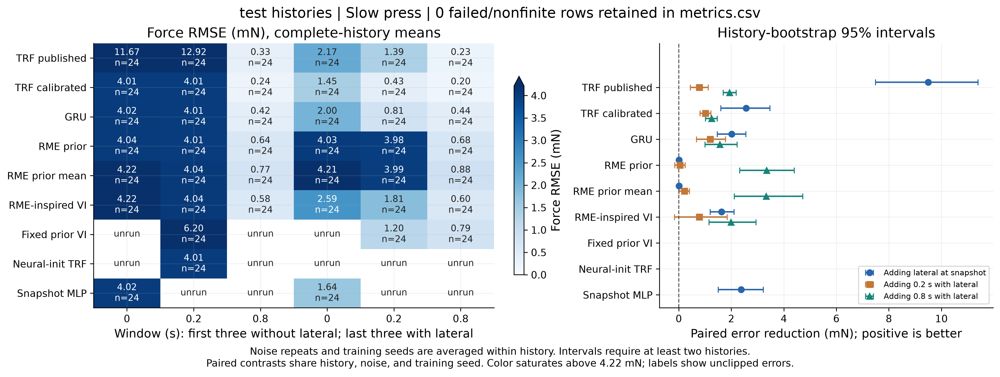
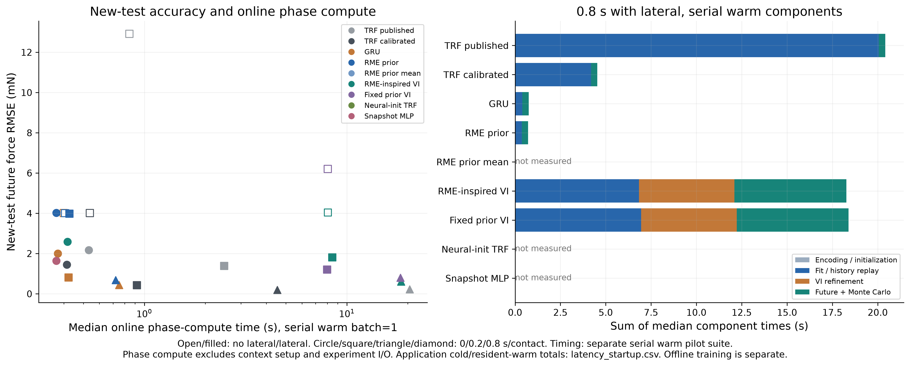
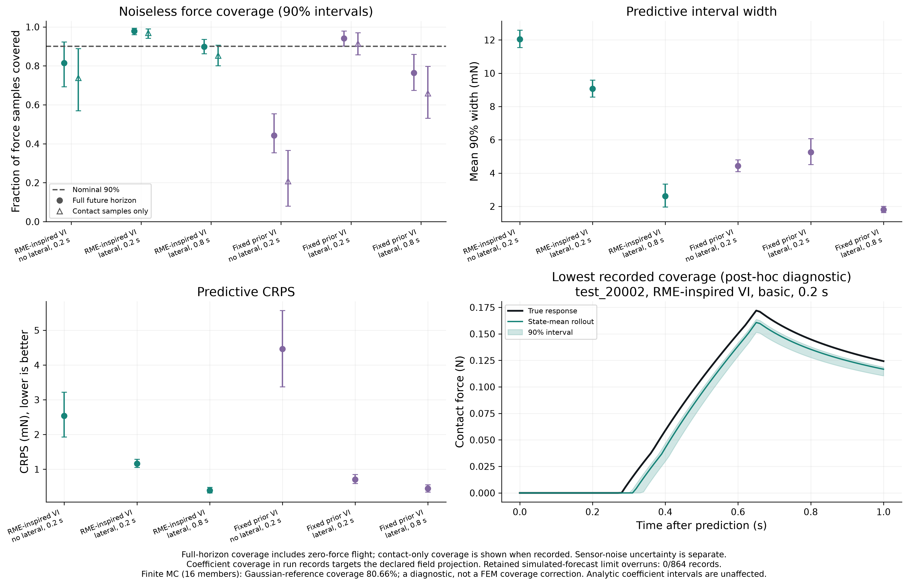

# Estimator choice, sensing and history

The new test contains **24 independent loading histories**, three sensor-noise repeats per history and three training seeds. All methods use the same spatial FEM, observation realizations, prediction cut and Slow/Fast commands. The earlier 24 histories are a separate, already-seen reanalysis.

Evaluation is complete: 72 old, 72 new and eight pilot history/noise jobs; **39,872 point-prediction rows and zero numerical failure events**. [Summary](summary.json) · [Raw metrics](metrics.csv) · [Protocol](../../../docs/INFERENCE_STUDY.md) · [RME source audit](../../../docs/RME_ADAPTATION.md).

## What the new test shows

Mean future-force RMSE in mN, Slow press. Noise repeats and training seeds are averaged within each physical history. B0/B2/B8 use motion and force; L0/L2/L8 also use lateral markers. Numbers denote the 0, 0.2 and 0.8 s observation windows.

| Method | B0 | L0 | B2 | L2 | B8 | L8 |
| --- | ---: | ---: | ---: | ---: | ---: | ---: |
| Original TRF | 11.666 | 2.167 | 12.915 | 1.389 | 0.334 | 0.231 |
| Calibrated TRF | 4.012 | 1.446 | 4.012 | **0.427** | **0.236** | **0.197** |
| GRU | 4.023 | 2.003 | 4.011 | 0.806 | 0.423 | 0.437 |
| RME neural center | 4.036 | 4.027 | 4.007 | 3.979 | 0.642 | 0.683 |
| RME-inspired VI | 4.221 | 2.590 | 4.038 | 1.808 | 0.582 | 0.605 |

The snapshot MLP gives 4.016 mN without lateral sensing and 1.641 mN with it. At the current-observation condition, a GRU has no additional history and does not improve on this MLP.

### Sensing and history

Current lateral shape helps all three main estimators, with different gains. Adding 0.2 s of lateral recovery history also helps calibrated TRF and GRU. The VI estimate has a positive mean improvement with a wider interval that includes zero.

| Paired improvement, mN [pointwise 95% interval] | Calibrated TRF | GRU | RME-inspired VI |
| --- | --- | --- | --- |
| Add current lateral shape | 2.565 [1.678, 3.476] | 2.019 [1.440, 2.513] | 1.631 [1.181, 2.092] |
| Current lateral → 0.2 s lateral | 1.019 [0.804, 1.221] | 1.197 [0.704, 1.794] | 0.782 [-0.118, 1.833] |
| Current lateral → 0.8 s lateral | 1.249 [1.019, 1.475] | 1.566 [0.998, 2.215] | 1.985 [1.189, 2.937] |

Intervals use 2,000 complete-history bootstrap resamples. Compared with calibrated TRF, the current-lateral gain is 0.546 mN smaller for GRU [-1.117, -0.021] and 0.934 mN smaller for VI [-1.719, -0.083]. Differences between their history gains have intervals crossing zero. These are pointwise comparisons; no equivalence or non-inferiority claim is made.

Without lateral sensing, both current and recent-wait calibrated TRF fits retain the training-mean coefficients exactly: all 144 fits stop after one evaluation with no coefficient change. Their roughly 4 mN accuracy is supplied by the training prior. GRU and the neural prior give similar errors in this weak-information condition. A good prediction here does not demonstrate recovery from the current observation.

The 0.8 s window contains earlier contact and motion. It improves every main estimator, while the recent 0.2 s window contains detached waiting. Earlier contact plus propagation gives calibrated TRF 0.346 mN without lateral sensing and 0.336 mN with it. This route uses about 0.66–0.69 s of motion, a 0.2 s observation update and a preceding force scan; it is not a 0.2 s total-history method.

The [common-anchor control](controls/common_anchor.json) keeps the same 0.60 s prior and 0.8 s motion span for four pilot histories. Lateral updates reduce mean error from 0.953 to 0.479 mN; force-only updates leave it unchanged. This small diagnostic separates observation updates from propagation and initialization. Recovery dynamics and repeated-measurement denoising are still combined.

### What VI adds

The bounded Gaussian's physical mean differs from the raw neural center. The same-summary prior control is therefore essential.

| Lateral condition | Neural center | Prior physical mean | VI physical mean |
| --- | ---: | ---: | ---: |
| Recent 0.2 s | 3.979 | 3.992 | 1.808 |
| Recent 0.8 s | 0.683 | 0.881 | 0.605 |
| Earlier contact + propagation | 0.780 | 0.704 | 1.093 |

At 0.2 s, VI improves on the same-summary prior by 2.184 mN [1.006, 3.442]. At 0.8 s, it improves on that control by 0.276 [0.071, 0.509], but the gain over the raw neural center is only 0.078 [-0.088, 0.250]. In the targeted contact condition, VI worsens the same-summary prior by 0.389 mN [0.068, 0.717]; contact comparisons use training seed 11 only.

The fixed-training-prior VI reaches 1.203 mN at lateral 0.2 s, outperforming the neural-prior VI's 1.808 mN there. Neural initialization followed by calibrated TRF matches the ordinary calibrated TRF means to six decimals in the three targeted conditions. A learned prior, a learned starting point and VI refinement provide different benefits; none wins uniformly.

The same estimated states predict Fast press without another fit. Lateral 0.8 s errors are 0.211 mN for calibrated TRF, 0.487 for GRU and 0.681 for VI. This supports reuse across the two tested press speeds. Controller benefit has not been tested.

## Cost and training

Representative application timing uses `pilot_14000`, lateral 0.8 s, Slow press, seed 11, CPU batch one and one numerical thread on an i9-12900K. All batch workers were stopped. Warm values are medians of three resident application calls and include masking/packing, inference, required history replay and future prediction. VI includes 16 posterior rollouts.

| Method | Resident warm call, s | Fresh-process cold call, s |
| --- | ---: | ---: |
| Calibrated TRF | 4.400 | 6.433 |
| GRU | 0.725 | 2.520 |
| RME-inspired VI | 17.344 | 20.831 |

GRU encoding takes about 1.6 ms; replay and future FEM prediction account for almost all of its application time. VI uses about 5.0 s for optimization and 11.6 s for posterior replay/prediction. Its point-only computation is about 5.8 s in this case. These timings establish a local accuracy/cost tradeoff, not a real-time robot result or population-wide latency bound.

The [phase-compute suite](latency.csv) excludes experimental setup, truth/projection diagnostics and I/O. The [application suite](latency_startup.csv) separately measures resident calls and fresh processes; OS filesystem caches are not flushed. Original RME's robot timing cannot be transferred to this FEM likelihood.

All learned methods share the full training-label set. The MLP receives the first frame of each labeled window. Mean coefficient-validation MSE over three seeds is:

| Model | 32 training histories | 128 training histories | Parameters |
| --- | ---: | ---: | ---: |
| GRU | 0.001098 | 0.000833 | 4,614 |
| RME-inspired encoder | 0.001108 | 0.000925 | 59,206 |
| MLP | 0.001036 | 0.000961 | 5,382 |

Validation selects 128 histories and learning rate 0.003. Error still decreases with training size, so this study does not establish a neural scaling limit. The model/scout phase took 1,197.64 s elapsed; data generation, physics checks and calibration are separate. The successful new-test batch took 4,668.33 s elapsed, with a separately recorded parallel tail and interrupted preliminary attempts. [Training records](checks/training_summary.json) · [Execution journal](execution/).

Across the three training seeds, the standard deviation of new-test mean force RMSE is 0.048/0.053 mN for GRU at lateral 0.2/0.8 s, and 0.238/0.046 mN for VI. This algorithmic variation is separate from the complete-history bootstrap intervals.

## Uncertainty

The table reports latent-force bands from 16 posterior samples. Coverage is averaged over each future trajectory and then over histories; frames are not independent statistical samples.

| Prior / condition | Full-future coverage | Contact-only coverage | Mean width, mN | Empirical CRPS, mN | Future noisy-observation coverage |
| --- | ---: | ---: | ---: | ---: | ---: |
| Neural, force-only 0.2 s | 81.45% | 73.90% | 12.042 | 2.539 | 77.11% |
| Neural, lateral 0.2 s | 97.91% | 96.94% | 9.072 | 1.165 | 90.47% |
| Neural, lateral 0.8 s | 89.82% | 85.28% | 2.618 | 0.393 | 83.76% |
| Fixed, force-only 0.2 s | 44.31% | 20.81% | 4.435 | 4.465 | 43.06% |
| Fixed, lateral 0.2 s | 94.14% | 91.53% | 5.261 | 0.706 | 86.80% |
| Fixed, lateral 0.8 s | 76.44% | 65.93% | 1.809 | 0.447 | 79.57% |

These are empirical 5%/95% sample quantiles. An independent [metric sanity check](verification/finite_mc_reference.json) using a correct Gaussian forecast, the same 16 samples and the same quantile rule covers **80.66%** [80.49%, 80.83%], although the exact Gaussian interval covers 90%. Thus sub-90% force-band coverage alone cannot diagnose posterior miscalibration. This Gaussian example is not a correction for nonlinear FEM force distributions or their zero-force atoms. Primary intervals and scores were kept unchanged.

In force-only waiting, the posterior logit means remain at their priors. An [actual-scale constant-likelihood check](verification/weak_prior_numerical_drift.json) finds a small KL/Adam numerical drift: maximum log-standard-deviation change 0.00862 and coefficient-mean shift 3.22e-6. Constant and real weak likelihoods produce identical results in that diagnostic, with exactly zero physical gradients. This tiny change is not observation information.

Analytic coefficient intervals have no 16-sample quantile bias. Neural-VI coefficient coverage is 58.8%, 57.0% and 64.6% in the three conditions above, against the declared field projection. This limits physical-coordinate uncertainty claims. Force intervals, coordinate intervals and future measurement-noise intervals answer different questions; this run does not establish a generally calibrated belief state.

## Checks and limits

- Original TRF's 1,152 old-batch force RMSEs reproduce the archive exactly. Its old/new optimization-cap counts are 201/576 and 214/576; calibrated TRF has zero cap stops in either batch.
- Sensor masking, common noisy observations, common commands, cross-action state reuse and frozen artifact/source checks pass. [Comparison audit](verification/comparison.json) · [Old audit](verification/old_reanalysis.json) · [New audit](verification/new_test_audit.json).
- All 19,296 new-test point forecasts and 13,824 posterior future trajectories pass the recorded future-physics checks. Inferred likelihood replay paths are not certified by that audit.
- Generated loading histories retain four small penetration overruns: `train_10070` 5.061543 um, `train_10074` 5.029799 um, `validation_12000` 5.000315 um and `test_20015` 5.029794 um against a 5 um criterion. The old batch's earlier overrun remains in its archive.
- The projected-state reference gives 0.0855 mN at lateral 0.8 s, versus calibrated TRF's 0.1971 mN. It demonstrates representational capacity; sensor ambiguity and noise can still prevent recovery. It is not a prediction-error or control-optimality bound.
- Test size was capped at 24 using pilot variance and measured cost. The pilot's worst-case 0.5 mN interval target would require 124 histories. No equivalence conclusion follows from this smaller batch.
- The exact-forecast cache was bounded after a memory restart, before any completed final-test job. [The execution amendment](verification/runtime_cache_amendment.json) preserves the original freeze and verifies bitwise-identical physical arrays with and without caching. Models, data, likelihood, seeds and analysis rules were unchanged.

## Next decision

Proceed with a small recursive classical observer that carries the contact estimate and its uncertainty through release and waiting. Compare per-step cost and prediction against this calibrated TRF and the amortized GRU on continuous histories and new prediction cuts. More neural training is justified if that comparison exposes a useful accuracy or timing gap.

Before scaling a common-feedback action experiment, establish that true-state access changes a meaningful task outcome under the same feedback, action set and realistic delay. The earlier 1D negative action result remains relevant. This 2D run supports information-use and computation comparisons; it does not establish a new inference principle, universal state sufficiency or robot-action benefit.

## Reproduce and inspect

Open [the Notebook](../../../notebooks/spatial_2d_hidden_state.ipynb) in the rebuilt Docker Dev Container and Run All. Section 6 presents these auxiliary methods; its explicit Recompute button writes a separate interactive record. Full training/batch commands are in [the protocol](../../../docs/INFERENCE_STUDY.md). Figures are also exported as SVG/PDF, with adjacent provenance JSON.

The repository includes all 39,872 point-prediction metric rows, aggregate results, configuration, data manifests, source snapshots, model weights and main checks. Interactive replay and recomputation include the prespecified first test history, `test_20000`, with all three noise repeats and training seeds. Aggregate figures still use all 24 new test histories. The full local archive also retains every physical trajectory, individual forecast and interrupted run; those repeated files are excluded from Git. Regenerate other trajectories with the protocol before replaying them or rebuilding all figures from curves.

The fresh disposable-container release check passed in 122.23 s: 22 tests, 17 physics checks, original widget callbacks and scientific figure/animation exports. The final clean-kernel Run All took **9.83 s**, with 13 sequential code cells and no error outputs. The inference-widget check took 8.88 s and covered all 16 replay conditions, seeds 11/23/37, shared baselines, the cursor and real GRU/TRF recomputation without changing the main metrics. These checks exercise native widget callbacks and ipympl; they do not represent manual VS Code frontend clicking.

[Executed Notebook](verification/release/executed_final.ipynb) · [Fresh-kernel record](verification/release/notebook_final.json) · [Container check](verification/release/validation.json) · [Widget check](verification/widget_test.json).

The compact publication was checked separately in a Git-only checkout inside Docker: 23 tests passed, clean-kernel Run All took 11.72 s, and the representative replay/recomputation callbacks passed. All 804 cached response rows for `test_20000` have their files; the complete metric table retains all 24 new histories. [Publication check](verification/publication/validation.json).
